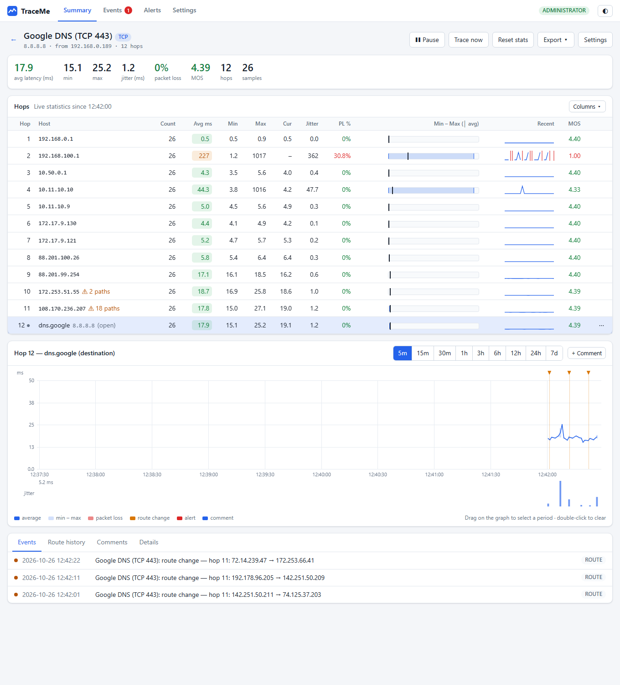
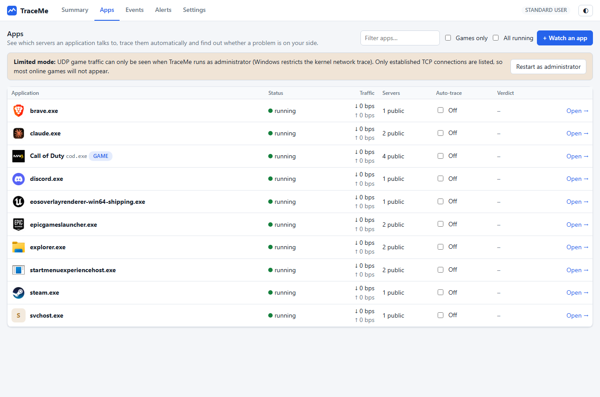

# TraceMe

**Find out where your lag and packet loss really come from, and whether it is your side or the server's.**

TraceMe is a free, open-source network monitor for Windows. It runs a continuous traceroute to any host, shows latency, jitter and
packet loss for every hop on live graphs, keeps the history, and alerts you when something degrades. Its **Apps** section goes
further: pick a game or any program, and TraceMe finds the servers it is talking to, traces them for you and tells you in plain words
whether the problem is your PC/router, your ISP, the internet in between, or the server.



## Why it exists

Diagnosing a laggy game by hand takes a long time: open Task Manager → Resource Monitor → Network, find the game's process, copy the
server IP from its connections, paste it into a traceroute tool, then work out which hop to blame. Routers that merely rate-limit their
replies also make a traceroute look worse than it is. TraceMe automates all of it and filters out that false loss.

## What you can do with it

- **Trace anything, continuously** with ICMP, UDP or TCP probes (IPv4 and IPv6), down to 0.2 s per trace.
- **See every hop live:** average / min / max / current latency, jitter, packet loss, MOS voice-quality score, reverse-DNS names,
  load-balanced paths, and a timeline you can zoom from 5 minutes to 7 days.
- **Select a time range** on the graph and get the statistics for exactly that period.
- **Trace a game or program automatically (Apps):** TraceMe reads which remote addresses a program uses (UDP games included, the same
  source Resource Monitor uses), ranks them to find the game server, traces it and shows a verdict with a path strip:
  *You → your PC & router → your ISP → the internet → the server*. Sessions are recorded and end with a printable report.
  Program icons are shown next to each name.
- **Get alerts** on latency, jitter, loss, no response, MOS or route changes: pop-up, sound, email (SMTP), webhook, a JavaScript snippet,
  or running a program (off by default).
- **Keep and export history:** SQLite storage, CSV export, timeline image, route history, comments on the timeline.
- **Customise:** your own columns written in JavaScript (sandboxed), light and dark themes, workspace export/import.
- **Trace from another machine:** run a second TraceMe as a remote agent and view its results locally.



## Is it free?

Yes. TraceMe is free for personal and commercial use and open source under the [MIT License](LICENSE). There are no accounts, no ads
and no telemetry. It runs entirely on your PC and does not send your data anywhere. The only optional external lookup is the AS-owner
lookup (Team Cymru), which is off until you turn it on.

## Install (Windows 10 / 11, 64-bit)

1. Go to the **[Releases page](https://github.com/sa3oodi/TraceMe/releases)** and download `TraceMe-Setup-<version>.exe`.
2. Run it and follow the wizard. Nothing else needs to be installed; the .NET runtime is included.
3. Start **TraceMe** from the Start menu. Windows asks for administrator permission; accept it. TraceMe then opens in your browser at
   `http://127.0.0.1:5055`.
4. To quit, close the TraceMe console window.

The installer is not code-signed yet, so Windows SmartScreen may show "Windows protected your PC" on first run. Choose **More info →
Run anyway**. You can also build the installer yourself from the source (below) and compare.

**Uninstall:** Settings → Apps → TraceMe. You are asked whether to keep or delete your history.

### Why administrator rights?

Windows only lets a program read the router replies of UDP and TCP traces, and the per-program network trace used by **Apps**, when it
runs as administrator. ICMP traces work without it. Without administrator rights TraceMe still runs, shows what it can, and says what
is limited.

## Quick start

- **Trace a host:** Summary → **+ Add target**, enter an address (e.g. `8.8.8.8`), pick ICMP, UDP or TCP.
- **Check a game:** Apps → **+ Watch an app**, type the program name (e.g. `cod.exe`), start the game. TraceMe finds the server and
  shows the verdict. Details and limits: [docs/APPS.md](docs/APPS.md).
- **Which method?** Start with ICMP. If the last hop never answers, try UDP (games use UDP), or TCP on port 443 or 80.

## Trace methods

| Method | How it works | Needs administrator? |
|---|---|---|
| **ICMP** | Echo requests with increasing TTL through the Windows ICMP API. IPv4 and IPv6. | No |
| **UDP** | Datagrams to a configurable port (default 33434) with increasing TTL. Routers answer with ICMP *Time Exceeded*, the target with *Port Unreachable* or a UDP reply. | To read **router addresses** |
| **TCP** | SYN probes to a port (default 80) with increasing TTL; gets through firewalls that drop ICMP and UDP. | To read **router addresses** |

## Good to know (limits)

- A trace measures the **path**, not your game's own connection. Servers and routers often ignore or rate-limit probes, so a hop with
  loss that disappears further along is usually harmless, and a server that never answers is normal. TraceMe's verdict accounts for
  this, but a trace can still disagree with what the game shows; trust the game's own loss figure when they differ.
- Apps detection and the verdicts were tested with a stand-in program that behaves like a game. Real games and their anti-cheat have not
  been systematically tested, and remote IPv6 paths could not be tested.
- Windows only. No desktop service or kernel driver, no PDF reports (the HTML report can be printed to PDF), no geo-location maps, no
  scheduled trace windows.

## Security

- Listens on **127.0.0.1 only** by default; requests need a loopback `Host` header (DNS-rebinding defence) and writes need the
  `X-TraceMe` header and a same-origin `Origin` (CSRF defence).
- To listen on other addresses set `TRACEME_URL=http://0.0.0.0:5055`; an access token is then required.
- Alert actions that run programs are **off** by default, cannot be enabled by an imported file, and take arguments without a shell.
  Scripts run in a sandbox without file, network or process access.
- Passwords and tokens are masked in the UI and API and left out of exports. They are stored unencrypted in your local database.

Found a security problem? Please open a private security advisory on the GitHub repository rather than a public issue.

## Build from source

Needs the [.NET 10 SDK](https://dotnet.microsoft.com/download).

```
cd src && dotnet run                      # http://127.0.0.1:5055 (use an elevated terminal for UDP/TCP and Apps)
dotnet test tests/TraceMe.Tests           # unit tests
installer\build.ps1                       # builds artifacts\TraceMe-Setup-<version>.exe (needs Inno Setup 6)
```

Options (arguments or environment variables): `--url=` / `TRACEME_URL` (default `http://127.0.0.1:5055`), `--data=` /
`TRACEME_DATA` (default `%LOCALAPPDATA%\TraceMe`), `--token=` / `TRACEME_TOKEN`, `--open`.

```
src/Apps        per-process traffic capture (ETW), server ranking, auto-trace rules and sessions, diagnosis, reports
src/Engine      probes (ICMP/UDP/TCP/agent), raw ICMP listener and parser, target runner, statistics
src/Data        SQLite layer (batched writer, window statistics, timeline buckets, route history, export)
src/Alerts      alert engine and actions
src/Services    settings, events, DNS, AS lookup, JavaScript host, elevation
src/Api         HTTP API and security middleware
src/wwwroot     web UI (plain ES modules, canvas graphs, no build step)
installer/      Inno Setup script and build script
tests/          xUnit tests
```

The HTTP API (JSON) lives under `/api`: `targets`, `events`, `alerts`, `settings`, `workspace`, `system`, `asn`, `agent`, `apps`.

## Contributing

Contributions are welcome. See [CONTRIBUTING.md](CONTRIBUTING.md) for how to build, test and what to keep in mind.

## License

MIT, copyright (c) 2026 Sayed Saeed. See [LICENSE](LICENSE) and [THIRD-PARTY-NOTICES.md](THIRD-PARTY-NOTICES.md). TraceMe is an
independent project and is not affiliated with PingPlotter.
